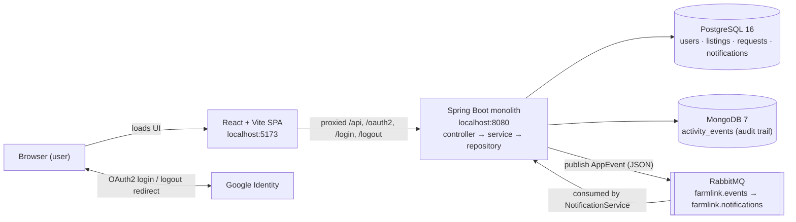

# FarmLink

**A local produce marketplace and order coordination platform** — smallholder farmers publish
produce listings, local businesses browse them and submit purchase requests, and farmers
accept or reject those requests. Notifications are delivered asynchronously through RabbitMQ,
and every meaningful action is recorded in an audit trail.

*Stack: Java 21 · Spring Boot 3.2.5 · PostgreSQL · MongoDB · RabbitMQ · Spring Security
(Google OAuth2/OIDC) · React 18 (Vite) · Docker Compose · GitHub Actions*

FarmLink is a **single layered Spring Boot monolith** (`controller → service → repository →
entity`) with a React single-page frontend. PostgreSQL is the source of truth, MongoDB stores
only activity/audit events, and RabbitMQ carries only meaningful application events.

---

## Table of contents

1. [Project Overview](#1-project-overview)
2. [Project Objectives](#2-project-objectives)
3. [Target Users and Roles](#3-target-users-and-roles)
4. [Core Features](#4-core-features)
5. [Technology Stack](#5-technology-stack)
6. [Architecture and Data Flow](#6-architecture-and-data-flow)
7. [Project Structure](#7-project-structure)
8. [Prerequisites](#8-prerequisites)
9. [Environment Configuration](#9-environment-configuration)
10. [Running the Project Locally](#10-running-the-project-locally)
11. [Testing and Build Verification](#11-testing-and-build-verification)
12. [Continuous Integration](#12-continuous-integration)
13. [Security and Validation](#13-security-and-validation)
14. [Scope and Limitations](#14-scope-and-limitations)
15. [Future Improvements](#15-future-improvements)
16. [Author and Academic Context](#16-author-and-academic-context)

---

## 1. Project Overview

Smallholder farmers often struggle to reach business buyers directly: produce availability is
shared informally, prices are opaque, and orders are coordinated by phone calls or
word of mouth with no record of who asked for what.

FarmLink addresses this with a focused web platform:

* **Farmers** publish produce listings (name, category, quantity in kg, price per kg in RWF,
  location, availability date) and manage them over time.
* **Buyers** (restaurants, shops, institutions) discover produce through search and filters,
  then send a structured **purchase request** for a specific quantity.
* **Farmers** accept or reject each request; the buyer is notified, and stock is deducted
  when a request is accepted.

The intended users are farmers, local business buyers, and a platform administrator. The
practical value is a transparent, auditable ordering channel: prices and quantities are
visible up front, every request has a status, and both sides always see the current state
without phone coordination.

## 2. Project Objectives

1. **Make produce easy to discover** — a public marketplace with text search plus category
   and location filters, backed by dynamic filter options taken from real listings.
2. **Enable structured buying interest** — let authenticated buyers submit purchase requests
   (quantity + optional message) against active listings, with server-side checks that the
   requested quantity exists.
3. **Let farmers manage their side** — create, edit, deactivate and reactivate listings, and
   answer incoming requests with a one-click accept/reject workflow.
4. **Keep everyone informed** — deliver in-app notifications asynchronously (RabbitMQ) when
   a request is accepted or rejected, and keep a queryable activity trail (MongoDB).
5. **Enforce access control** — role-based permissions (FARMER / BUYER / ADMIN) enforced on
   the server for every protected operation, not merely hidden in the UI.

## 3. Target Users and Roles

Roles are assigned at first login and are enforced by Spring Security on every request.
A user without a role is in an onboarding state and can only read `/api/me` and choose a role.

| Role | Enforced permissions (server-side) |
|---|---|
| **FARMER** | View own listings including inactive ones (`GET /api/listings/mine`); create listings (`POST /api/listings`); edit own listings (`PUT /api/listings/{id}` — non-owners get 403); view incoming purchase requests; accept/reject pending requests **on listings they own** |
| **BUYER** | View own purchase requests; create purchase requests against active listings (`POST /api/requests`); everything farmer/admin-only returns 403 |
| **ADMIN** | All `/api/admin/**` endpoints (stats, users, listings, activity); update/deactivate any listing (`PUT /api/listings/{id}`); view all purchase requests. Admins cannot accept/reject requests they do not own — that check is ownership-based, not role-based |

Reading the marketplace (listing browse, facets, details) is public; every other operation
requires login and the matching role — see the [API table](#api-surface).

**First-time onboarding.** A Google account that logs in for the first time has **no role**
(`role: null`). The frontend shows an onboarding screen where the user chooses *I'm a farmer*
or *I'm a buyer*; the choice is saved once via `POST /api/me/role` and can never be changed
(a second attempt returns 409). Only `FARMER` and `BUYER` can be self-selected — submitting
`ADMIN` is rejected with 400.

**Administrator access.** Admin accounts are configured **only** through the server-side
`ADMIN_EMAILS` environment variable (comma-separated Google e-mail addresses). Addresses on
this allowlist are recognised as `ADMIN` on every login. There is no self-service path to
admin. Optionally, `FARMER_EMAILS` gives listed addresses the `FARMER` role automatically on
first login (skipping onboarding); everyone else picks a role themselves.

**Note on UI vs. server.** The frontend also hides dashboards that do not match your role,
but this is convenience only — the API returns 401 (not logged in) or 403 (wrong role)
regardless of what the UI shows.

## 4. Core Features

### Authentication and authorization

* Sign in with **Google (OAuth2 / OIDC)** — no local passwords exist in the system.
* Session-based security (HTTP session cookie); unauthenticated API calls receive a JSON
  `401`, not a redirect.
* First-login onboarding chooses FARMER or BUYER exactly once; ADMIN is never self-selectable
  and comes only from the `ADMIN_EMAILS` allowlist.

### Produce marketplace and listing management

* Public marketplace listing only **ACTIVE** listings, with **search by name**, **category
  filter** and **location filter** (filter options come from `GET /api/listings/facets`,
  i.e. the distinct categories/locations of real listings).
* Listing detail page with price per kg (RWF), quantity available, location, availability
  date, description and the farmer's name.
* Farmers create listings, edit all fields, and **deactivate/reactivate** listings
  (inactive listings disappear from the marketplace but keep their request history).
* Validation on every write: name/category/location required, quantity > 0, price > 0,
  availability date required, description ≤ 2000 characters.

### Purchase-request lifecycle

* A buyer opens an active listing and submits a request for a quantity (kg) with an optional
  message (≤ 500 characters).
* Server-side rules: quantity must be positive and **not exceed available stock**; only
  listings with status `ACTIVE` can be requested; one buyer holds many requests, each
  pointing at one listing.
* The listing owner (farmer) **accepts or rejects** pending requests. Only the owner may
  process a request, only while it is `PENDING`, and accepting re-checks that the quantity
  is still available. Accepted requests **deduct the quantity** from the listing.
* Buyers track every request with status badges (Pending / Accepted / Rejected) and tab
  filters on their dashboard.

### Post-acceptance contact sharing

* Once a request is **ACCEPTED**, both participants can see each other's contact details:
  name, Google e-mail, and an optional phone number the user may add on their profile
  page (`PUT /api/me/phone`, max 30 characters, blank clears it).
* Each accepted request shows the counterparty's details together with a short instruction
  to coordinate collection or delivery — on the farmer's dashboard (buyer's details) and
  the buyer's dashboard (farmer's details).
* **Enforced in the backend, not just the UI** (`GET /api/requests/{id}/contact`): only the
  buyer and the listing owner may see each other's details, and only while the request is
  `ACCEPTED`. Pending and rejected requests share nothing (403); everyone else — including
  admins and other farmers — gets 403; unauthenticated calls get 401.
* Contact details never appear in public listings, request lists, notification payloads or
  the admin user list, and users without a phone number are handled gracefully (e-mail
  remains the reliable channel).
* **Limitations:** there is still no in-app chat or messaging (out of scope) — the feature
  only reveals existing contact information; the phone number is optional, so e-mail is the
  only guaranteed channel; and once accepted, the two participants keep access to each
  other's details (no expiry or revocation).

### Notifications and activity/audit events

* Accepting or rejecting a request publishes an event to RabbitMQ
  (`farmlink.events` exchange → `farmlink.notifications` queue, JSON payloads). A dedicated
  consumer stores a `Notification` row for the target user, decoupling the HTTP request from
  notification delivery.
* The navbar shows a notification bell (badge count, dropdown list, newest first); the
  frontend refreshes it every 15 seconds.
* Every listing and request action writes an activity event
  (`LISTING_CREATED`, `LISTING_UPDATED`, `PURCHASE_REQUEST_CREATED`,
  `PURCHASE_REQUEST_ACCEPTED`, `PURCHASE_REQUEST_REJECTED`) to MongoDB — visible in the
  admin dashboard as a recent-activity audit trail.

### Administration and dashboards

* **Farmer dashboard** — stat cards (active listings, pending/accepted requests, totals),
  listing management with inline create/edit form, accept/reject buttons on incoming
  requests, and a recent-listings overview.
* **Buyer dashboard** — stat cards and a tabbed list of own requests with status filters.
* **Admin dashboard** — platform stats (users, farmers, buyers, active listings, requests,
  pending requests), the MongoDB activity trail, a user list with roles, and a listings tab
  that can deactivate/re-activate any listing.

### API surface

| Method | Path | Access | Description |
|---|---|---|---|
| GET | `/api/health` | public | Liveness check |
| GET | `/api/listings?search=&category=&location=` | public | Browse **ACTIVE** listings |
| GET | `/api/listings/facets` | public | Distinct categories + locations (filter options) |
| GET | `/api/listings/{id}` | public | Listing details |
| GET | `/api/listings/mine` | FARMER | Own listings (incl. inactive) |
| POST | `/api/listings` | FARMER | Create listing → 201 |
| PUT | `/api/listings/{id}` | FARMER/ADMIN | Update listing / status (owner enforced) |
| GET | `/api/requests` | authenticated | Buyer: own · Farmer: incoming · Admin: all |
| POST | `/api/requests` | BUYER | Submit request (`PENDING`) → 201 |
| GET | `/api/requests/{id}/contact` | buyer + listing owner, `ACCEPTED` only | Both participants' contact details + coordination instruction; 403 for pending/rejected requests and for everyone else |
| PUT | `/api/requests/{id}/accept` | listing owner | `PENDING → ACCEPTED`, deducts stock |
| PUT | `/api/requests/{id}/reject` | listing owner | `PENDING → REJECTED` |
| GET | `/api/notifications` | authenticated | Own notifications |
| GET | `/api/me` | authenticated | Current user (`role: null` → onboarding pending; includes own optional phone) |
| POST | `/api/me/role` | authenticated | First-time onboarding `{"role":"FARMER"\|"BUYER"}`; 409 if already set; ADMIN rejected with 400 |
| PUT | `/api/me/phone` | authenticated | Store or clear own optional phone number (≤ 30 chars; blank clears) |
| GET | `/api/admin/stats` | ADMIN | User / listing / request counters |
| GET | `/api/admin/activity` | ADMIN | 20 most recent activity events |
| GET | `/api/admin/users` | ADMIN | All users |
| GET | `/api/admin/listings` | ADMIN | All listings (any status) |

## 5. Technology Stack

| Technology | Role in this project |
|---|---|
| **Java 21** | Backend language (matches `pom.xml` and CI) |
| **Spring Boot 3.2.5** | Application framework: REST controllers, services, JPA repositories, configuration |
| **Spring Data JPA (Hibernate)** | Persistence to PostgreSQL; schema managed with `ddl-auto: update` plus a startup migration (`schema.sql`) |
| **Bean Validation (jakarta)** | Declarative input validation on request DTOs (`@NotBlank`, `@NotNull`, `@Positive`, `@Size`) |
| **Spring Security + Google OAuth2/OIDC** | Login via Google, session-based authorization, role rules per endpoint |
| **PostgreSQL 16** | Primary relational data: users, listings, purchase requests, notifications |
| **MongoDB 7** | Activity/audit events only (`activity_events` collection) — deliberately not used for business data |
| **RabbitMQ 3 (management plugin)** | Asynchronous delivery of notification events between the API and the notification consumer |
| **React 18 + Vite 5** | Single-page frontend; Vite dev server proxies API/auth traffic to the backend |
| **Docker Compose** | One-command local infrastructure: PostgreSQL, MongoDB, RabbitMQ |
| **Maven (wrapper `mvnw.cmd` / `mvnw`)** | Build and test automation; no global Maven install needed |
| **GitHub Actions** | CI: backend unit tests, backend integration tests against real services, frontend production build |

## 6. Architecture and Data Flow

FarmLink is a **monolith**, not a microservices system: one Spring Boot application contains
all layers and both the public API and the RabbitMQ notification consumer.



**Roles of the three services**

* **PostgreSQL** — the source of truth for all business data (four tables: `users`,
  `produce_listings`, `purchase_requests`, `notifications`). Schema is created/updated by
  Hibernate (`ddl-auto: update`); `schema.sql` additionally drops an old `NOT NULL`
  constraint from pre-existing databases so `users.role` can be null during onboarding.
* **MongoDB** — stores activity events only, keeping the audit trail out of the relational
  schema while still being queryable by the admin dashboard.
* **RabbitMQ** — decouples request processing from notification delivery. The API publishes
  a JSON `AppEvent` to the topic exchange `farmlink.events` (routing key `farmlink.event`);
  the queue `farmlink.notifications` is bound to it, and `NotificationService` consumes the
  queue and writes the notification for the target user.

**Example flow — a buyer requests produce**

1. Buyer submits `POST /api/requests` (React → Vite proxy → Spring Boot).
2. The service validates the listing is `ACTIVE` and the quantity is available, saves the
   request as `PENDING`, and records a `PURCHASE_REQUEST_CREATED` activity event (MongoDB).
3. The farmer accepts via `PUT /api/requests/{id}/accept`: the request becomes `ACCEPTED`,
   listing stock is deducted, and a `PURCHASE_REQUEST_ACCEPTED` event is published to
   RabbitMQ.
4. The RabbitMQ consumer stores a notification for the buyer; the buyer's navbar bell
   (polled every 15 s) shows *"Your purchase request … has been accepted."*

## 7. Project Structure

```
farmlink/
├── README.md
├── .env.example              # environment template (copy to .env, never commit .env)
├── .gitignore
├── docker-compose.yml        # local PostgreSQL + MongoDB + RabbitMQ
├── .github/
│   └── workflows/
│       └── ci.yml            # CI pipeline (3 jobs)
├── backend/
│   ├── mvnw, mvnw.cmd        # Maven wrapper (no global Maven needed)
│   ├── pom.xml               # Spring Boot 3.2.5, Java 21
│   └── src/
│       ├── main/java/com/farmlink/
│       │   ├── FarmlinkApplication.java
│       │   ├── config/       # SecurityConfig, RabbitConfig, GoogleOAuth2UserService
│       │   ├── controller/   # User, Listing, Request, Notification, Admin, Health
│       │   ├── dto/          # validated request records + AppEvent
│       │   ├── entity/       # User, ProduceListing, PurchaseRequest, Notification,
│       │   │                 # ActivityEvent + enums (Role, statuses, ActivityType)
│       │   ├── exception/    # ApiException, ApiError, GlobalExceptionHandler
│       │   ├── repository/   # Spring Data JPA repositories (5)
│       │   └── service/      # business logic, event publisher + MQ consumer
│       ├── main/resources/   # application.yml, schema.sql
│       └── test/java/com/farmlink/
│           ├── FarmLinkIntegrationTest.java   # 17 integration tests (flag-gated)
│           └── service/       # ListingServiceTest, PurchaseRequestServiceTest, UserServiceTest
└── frontend/
    ├── index.html
    ├── package.json, package-lock.json
    ├── vite.config.js        # dev server :5173 + proxy to :8080
    ├── public/farm-hero.webp
    └── src/
        ├── main.jsx, App.jsx, api.js, styles.css
        └── components/       # Marketplace, ListingDetails, Onboarding,
                              # FarmerDashboard, BuyerDashboard, AdminDashboard,
                              # Navbar, Profile, ui
```

Generated folders (`backend/target/`, `frontend/node_modules/`, `frontend/dist/`) and local
log files are omitted — they are not part of the repository.

## 8. Prerequisites

| Requirement | Version / notes |
|---|---|
| **Java JDK** | **21** — matches `pom.xml` (`java.version=21`) and CI (Eclipse Temurin 21) |
| **Node.js + npm** | **Node.js 20** (the version CI uses) with npm; `npm ci` requires the committed `package-lock.json` |
| **Docker Desktop** (or Docker Engine) | Any recent version with the **Compose** plugin — provides PostgreSQL, MongoDB and RabbitMQ locally |
| **Git** | To clone the repository |
| **Google account** | To create OAuth2 credentials and to sign in (login is Google-only) |
| **Shell** | Commands below are written for **Windows PowerShell** (VS Code's integrated terminal works as-is) |

No global Maven install is required (the Maven wrapper is included), and no local
PostgreSQL/MongoDB/RabbitMQ install is required (Docker provides them).

## 9. Environment Configuration

Secrets are never hard-coded. Every value is read in
`backend/src/main/resources/application.yml` as `${VARIABLE:default}` — the backend even
starts with defaults, but **Google login will not work until the OAuth variables are set**.

1. Copy the template at the repository root (the copy, `.env`, is listed in `.gitignore`
   and must never be committed):

   ```powershell
   Copy-Item .env.example .env
   ```

2. Fill in `.env` — these are the only variables the project reads:

   | Variable | Purpose | Default |
   |---|---|---|
   | `DATABASE_PASSWORD` | PostgreSQL password (matches `docker-compose.yml`) | `farmlink` |
   | `RABBITMQ_PASSWORD` | RabbitMQ password (matches `docker-compose.yml`) | `farmlink` |
   | `GOOGLE_CLIENT_ID` | Google OAuth2 client ID | `not-configured` |
   | `GOOGLE_CLIENT_SECRET` | Google OAuth2 client secret | `not-configured` |
   | `FARMER_EMAILS` | Optional comma-separated e-mails that become FARMER on first login | empty |
   | `ADMIN_EMAILS` | Comma-separated e-mails that become ADMIN on every login — the only way to obtain admin | empty |
   | `FARMLINK_FRONTEND_URL` | React origin for CORS and post-login redirect | `http://localhost:5173` |

3. **Google OAuth credentials (once per Google Cloud project):**

   1. Open [Google Cloud Console](https://console.cloud.google.com/) → **APIs & Services →
      Credentials → Create credentials → OAuth client ID**.
   2. Application type: **Web application**.
   3. Authorised redirect URI (must match exactly):
      `http://localhost:8080/login/oauth2/code/google`
   4. Copy the client ID and secret into `GOOGLE_CLIENT_ID` / `GOOGLE_CLIENT_SECRET`.
   5. While the OAuth app is in *Testing* mode, add each Google account you will demo with
      as a **test user**, or publish the app. The frontend shows a helpful error banner
      (`?login=error`) if login is refused.

4. `.env` is only a local store — nothing loads it automatically. The terminal that starts
   the backend must have the values in its environment (see the snippet in the next section).

**Never commit `.env`, client secrets, or real credentials.** The Docker services use the
local development credentials `farmlink` / `farmlink` (defined in `docker-compose.yml`);
these are defaults for a localhost-only stack, not secrets.

## 10. Running the Project Locally

> All commands are run from the repository root in **Windows PowerShell**.
> Three terminals are used and labelled **A**, **B**, **C** below.

**1. Clone the repository**

```powershell
git clone https://github.com/Liesse205/FarmLink.git
cd FarmLink
```

**2. Configure environment variables** — copy `.env.example` to `.env` and edit it as
described in [§9](#9-environment-configuration).

**3. Terminal A — start the infrastructure** (PostgreSQL `:5432`, MongoDB `:27017`,
RabbitMQ `:5672`, management UI `:15672`):

```powershell
docker compose up -d
docker compose ps     # all three services should be "running"
```

**4. Terminal B — start the Spring Boot backend** (first run downloads Maven dependencies
and takes a few minutes):

```powershell
# load .env into this terminal's environment
Get-Content .env | ForEach-Object {
  if ($_ -match '^\s*([A-Za-z_][A-Za-z0-9_]*)=(.*)$') {
    [Environment]::SetEnvironmentVariable($Matches[1], $Matches[2].Trim(), 'Process')
  }
}

cd backend
.\mvnw.cmd spring-boot:run
```

Verify: <http://localhost:8080/api/health> returns `{"status":"UP"}`.

**5. Terminal C — install frontend dependencies and start Vite** (`npm ci` installs exactly
the versions in `package-lock.json`):

```powershell
cd frontend
npm ci
npm run dev
```

**6. Open the app** — <http://localhost:5173> and click **Login with Google**.

| URL | What |
|---|---|
| `http://localhost:5173` | FarmLink frontend (Vite dev server) |
| `http://localhost:8080/api/health` | Backend liveness check |
| `http://localhost:15672` | RabbitMQ management UI (user/pass: `farmlink`/`farmlink`) |

The Vite dev server proxies `/api`, `/oauth2`, `/login` and `/logout` to `:8080`, so no CORS
configuration is needed during development.

**Stopping everything**

* `Ctrl+C` in terminals **B** and **C** stops the backend and frontend.
* `docker compose stop` (in any terminal, repo root) stops the infrastructure containers;
  `docker compose up -d` starts them again. Add `-v` to `docker compose down` only if you
  also want to **delete the stored data** (listings, users) — this cannot be undone.

**Troubleshooting**

* **`password authentication failed for user "farmlink"` on startup** — a PostgreSQL
  service already running on your machine occupies port `5432` and shadows the container.
  Stop the local service (e.g. `net stop postgresql-x64-…` as administrator, or stop it in
  Services.msc) and retry. The credentials themselves are correct.
* **Redirected to `?login=error` after "Login with Google"** — `GOOGLE_CLIENT_ID` /
  `GOOGLE_CLIENT_SECRET` not loaded in terminal B, the redirect URI does not match exactly,
  or the Google account is not a test user while the app is in *Testing* mode.
* **401/403 from the API** — 401 means not logged in (or an unknown user); 403 means the
  wrong role for that endpoint. Both are expected server responses, not crashes.

## 11. Testing and Build Verification

Run these from the repository root in PowerShell.

**Backend unit tests** (no external services needed):

```powershell
cd backend
.\mvnw.cmd test
```

Currently **23 unit tests** across `ListingServiceTest`, `PurchaseRequestServiceTest` and
`UserServiceTest`. They verify, with mocked repositories: listing validation and ownership,
purchase-request rules (quantity bounds, active listing, owner-only processing, stock
deduction), the onboarding rules (new account has no role, ADMIN allowlist, role chosen
once, ADMIN never self-selectable), the post-acceptance contact-sharing rules (participants
only, accepted only, graceful when no phone is on file) and the optional phone number
(saves trimmed, blank clears, unknown caller rejected).

**Backend integration tests** (require the Docker services from [§10](#10-running-the-project-locally)
step 3 to be running):

```powershell
.\mvnw.cmd test -Dfarmlink.integration=true
```

Currently **17 integration tests** in `FarmLinkIntegrationTest`. They are flag-gated
(`-Dfarmlink.integration=true`) and are **skipped** by a plain `mvnw test`, so unit-test runs
never need infrastructure. They boot the full application against real PostgreSQL, MongoDB
and RabbitMQ and exercise real HTTP calls: public vs. protected endpoints, 401/403 RBAC,
first-time role onboarding, admin dashboard access, farmer listing CRUD with the MongoDB
activity record, marketplace search/category/location filters and facets, over-requesting
produce, owner-only accept/reject, reprocessing a processed request, stock deduction, the
RabbitMQ notification reaching the buyer, and the contact-sharing rules (accepted requests
reveal both participants to each other, pending/rejected requests and non-participants are
refused, contact details never leak into public or unrelated responses, and the optional
phone number validates, saves and clears). Tests create and clean up their own
`it-*@example.com` users.

**Frontend production build:**

```powershell
cd frontend
npm ci
npm run build
```

Vite bundles the app into `frontend/dist/` — this verifies the production bundle compiles
(it also runs in CI; there is no frontend test suite).

**Continuous integration:** every push and pull request runs the full matrix in GitHub
Actions — see [§12](#12-continuous-integration). A green run means the unit tests, the
integration tests against real services, and the frontend production build all passed.

## 12. Continuous Integration

The workflow lives in `.github/workflows/ci.yml` and **runs on:**

* pushes to the `main` and `feature/github-actions-ci` branches,
* every pull request (any branch).

It contains three independent jobs on `ubuntu-latest`:

| Job | Setup | Command | Verifies |
|---|---|---|---|
| **Backend unit tests** | Temurin JDK 21, Maven cache | `./mvnw -B test` | Business and onboarding rules without infrastructure |
| **Backend integration tests** | JDK 21 + service containers `postgres:16`, `mongo:7`, `rabbitmq:3-management` (with health checks, credentials matching the app defaults) | `./mvnw -B test -Dfarmlink.integration=true` | The full stack — RBAC, onboarding, listing/request workflows, MongoDB audit records and RabbitMQ notifications — against real services |
| **Frontend production build** | Node.js 20, npm cache keyed on `frontend/package-lock.json` | `npm ci && npm run build` | Dependencies install cleanly and the production bundle builds |

A passing result means all three succeeded — i.e. the backend's rules hold both in isolation
and end-to-end against real PostgreSQL/MongoDB/RabbitMQ, and the frontend ships a buildable
bundle. It does not cover browser-level UI testing (there is none yet — see §15).

## 13. Security and Validation

Verified protections implemented in the codebase:

* **Server-side role rules** — every protected endpoint has an explicit rule in
  `SecurityConfig` (see the [API table](#api-surface)); unauthenticated API requests get a
  JSON `401`, wrong-role requests get `403`.
* **Ownership checks in the service layer** — a farmer can only edit their own listings and
  only accept/reject requests on listings they own; other users (including admins for
  request processing) receive `403`. Accepting a request re-validates status and stock.
* **Participant-only contact sharing** — contact details (e-mail, optional phone) are only
  returned by `GET /api/requests/{id}/contact`, only for `ACCEPTED` requests, and only to
  the buyer and the listing owner (checked in `PurchaseRequestService.contact`); everyone
  else receives 403 and unauthenticated callers 401. Contact fields are not part of any
  listing, request-list, notification or admin response, and users can only edit their own
  phone number (`PUT /api/me/phone`).
* **Input validation** — Jakarta Bean Validation on all request DTOs (`@NotBlank`,
  `@NotNull`, `@Positive`, `@Size`) plus service-level rules (e.g. request quantity ≤
  available stock). Validation failures return 400 with a field-level message.
* **Consistent error handling** — a single `GlobalExceptionHandler` maps all exceptions to
  one JSON shape and never leaks stack traces to clients:

  ```json
  { "timestamp": "2026-10-04T09:11:48Z", "status": 404, "error": "Not Found",
    "message": "Listing 999 not found", "path": "/api/listings/999" }
  ```

* **Secret management** — all secrets come from environment variables with safe defaults
  (§9); `.env` is git-ignored; nothing sensitive is committed.
* **OAuth-only authentication** — no passwords are stored or hashed anywhere; identity
  comes from Google (OIDC `openid, profile, email`).
* **CORS** — restricted to the configured frontend origin (`FARMLINK_FRONTEND_URL`) with
  credentials allowed; all other origins are rejected by the browser policy.

Honest statements about what is *not* implemented: CSRF protection is disabled (the API
relies on SameSite session cookies plus the CORS origin allowlist); there is no rate
limiting, no account deprovisioning UI, and session security defaults are otherwise left at
Spring Boot's standards. This design is appropriate for a coursework demo, **not** for
production deployment as-is.

## 14. Scope and Limitations

FarmLink deliberately focuses on **produce listings and purchase-request coordination**.
The following are out of scope and **not implemented**: online payments, delivery/shipping
tracking, in-app chat or messaging, maps, product reviews/ratings, e-mail or push
notifications (notifications are in-app only), listing photos, and any AI-based features.

Genuine limitations of the current implementation:

* Notifications have no read/unread state or deletion — the bell shows all notifications,
  newest first.
* Accepted purchase requests share contact details with the two participants **indefinitely**
  — there is no expiry, revocation, or un-accept action, and no in-app chat/messaging
  exists to fall back on (the feature only reveals contact information, it does not add
  communication). The phone number is optional, so e-mail is the only guaranteed channel.
* List endpoints return complete lists without pagination or infinite scroll — fine at
  coursework scale, not at marketplace scale.
* The database schema is managed with Hibernate `ddl-auto: update`, which is acceptable for
  development but not a substitute for versioned migrations in production.
* Demo data must be created by hand (log in as a farmer and publish listings); no seed
  script ships with the repository.

## 15. Future Improvements

The following are **future work, not existing features**:

1. **Request quantity updates and expiry** — let buyers adjust pending requests and
   auto-expire stale ones.
2. **Email notifications** — a second RabbitMQ consumer that sends real e-mails via an SMTP
   provider, reusing the existing event stream.
3. **Versioned database migrations** — replace `ddl-auto: update` with Flyway for
   production-grade schema management.
4. **Frontend test suite** — component tests (Vitest + React Testing Library) and a
   browser-level end-to-end flow (Playwright) wired into CI.
5. **Pagination and sorting** on marketplace and dashboard list endpoints.

---

## 16. Author and Academic Context

| Field | Value |
|---|---|
| **Student name** | Munyanturire Kaliza Liesse |
| **Course / module** | Web Technology and Internet |

---

*This project was developed as academic coursework. It is a demonstration system and is not
intended for production use.*
