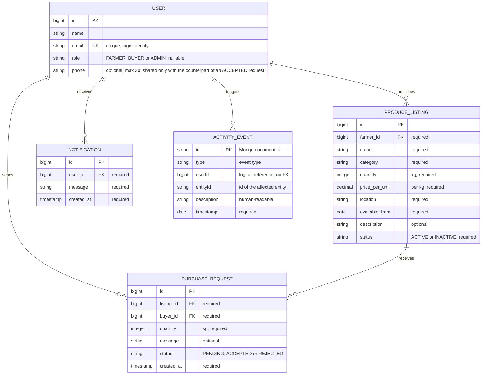

# GoFarm — Data Model Documentation

**Project:** GoFarm — Local Produce Marketplace & Order Coordination Platform
**Companion documents:** the root [`README.md`](../README.md) covers setup and usage; this
document describes *how the data is modelled and why*. Everything below is derived from the
actual code: JPA entities under `backend/src/main/java/com/farmlink/entity/`,
repositories under `repository/`, `application.yml`, `schema.sql`, `docker-compose.yml`,
and `RabbitConfig`. GoFarm is a **layered monolith**, not a microservices system.

---

## 1. Domain Overview

Independent of any technology, GoFarm coordinates one business process: **a farmer offers
produce, a buyer requests part of it, the farmer answers the request.**

**Actors:** Farmer (offers produce), Buyer (requests produce), Administrator (oversees the
platform), and the Platform itself (records activity and delivers notifications).

**Core process:**

1. A farmer publishes an *offer* of a quantity of produce at a price per unit, valid from a
   certain date, at a location.
2. A buyer sends a *request* for a specific quantity of that offer, with an optional
   message.
3. The farmer *accepts* (the requested quantity is removed from the offer) or *rejects* the
   request. Only pending requests can be processed, and only by the offer's owner.
4. The platform *notifies* the affected party and *records* every meaningful action as an
   immutable activity entry.

**Core data objects:** User (with a role), Produce Listing (the offer), Purchase Request
(the buyer's interest and its status), Notification (an in-app message for a user), and
Activity Event (an audit entry). All identifiers are opaque numeric keys; no business logic
depends on their values.

## 2. Conceptual Data Model

**Cardinalities:** one user (FARMER) → many listings; one listing → many purchase
requests; one user (BUYER) → many purchase requests; one user → many notifications. The
link from an activity event to a user is **logical only** (`userId` is stored as a plain
value in MongoDB, with no foreign key).

## 3. Entity Descriptions

| Entity | Responsibility |
|---|---|
| **User** | A platform participant identified by their Google e-mail. The `role` is nullable on purpose: `null` means first-login onboarding has not been completed, and such users can do nothing except read `/api/me` and choose a role. Roles are immutable once set. An optional `phone` (max 30 characters) can be added by the user themselves; together with the Google e-mail it forms the contact details that are shared **only** with the counterpart of an accepted purchase request (§7). |
| **ProduceListing** | A farmer's offer. Always created with status `ACTIVE`; `INACTIVE` listings are hidden from the marketplace but keep their history. References its farmer (required, lazily loaded). |
| **PurchaseRequest** | A buyer's structured interest in a quantity of a listing, with an explicit status lifecycle (`PENDING → ACCEPTED | REJECTED`) and a creation timestamp. Stores the quantity independently of the listing so history survives later stock edits. |
| **Notification** | A single in-app message for one user, created only by the RabbitMQ consumer. Newest-first listing per user; there is no read/unread flag (documented limitation). |
| **ActivityEvent** | An immutable audit entry (what happened, who did it, to which entity, when) stored in MongoDB, deliberately outside the relational schema. |

## 4. Technology-Oriented Schema (PostgreSQL)

Schema is produced by Hibernate from the entity annotations
(`spring.jpa.hibernate.ddl-auto: update`), so the tables below reflect what Hibernate 6
generates on PostgreSQL. `ddl-auto: update` **adds/updates but never drops** — a safe
choice for coursework, not a substitute for versioned migrations. Additionally,
`backend/src/main/resources/schema.sql` runs `alter table users alter column role drop not null;`
so databases created before the onboarding feature also allow a null role.

All primary keys are `bigint GENERATED BY DEFAULT AS IDENTITY` (Java `Long`,
`GenerationType.IDENTITY`). Enum fields are stored as strings
(`@Enumerated(EnumType.STRING)`), max length 20. Foreign keys are created by Hibernate
from `@ManyToOne` mappings (constraint names are Hibernate-generated). **No CHECK
constraints exist** — value positivity and quantity limits are enforced in the service and
DTO layers (see §7), not in the database.

### 4.1 `users`

| Column | Type | Null | Notes |
|---|---|---|---|
| `id` | bigint (identity) | No | Primary key |
| `name` | varchar(255) | No | From the Google profile |
| `email` | varchar(255) | No | Login identity |
| `role` | varchar(20) | **Yes** | `FARMER` / `BUYER` / `ADMIN`; `null` = onboarding pending |
| `phone` | varchar(30) | **Yes** | Optional phone number the user adds themselves (`PUT /api/me/phone`, blank clears it). Added automatically by Hibernate `ddl-auto: update` on first startup after the feature landed — no `schema.sql` change was needed. Never returned by any listing, request-list, notification or admin endpoint; only on `/api/me` (own number) and `GET /api/requests/{id}/contact` (counterpart of an accepted request, §7) |

*Indexes:* `idx_users_email` — **unique** index on `email` (`@Index(unique = true)` in
`User`).

### 4.2 `produce_listings`

| Column | Type | Null | Notes |
|---|---|---|---|
| `id` | bigint (identity) | No | Primary key |
| `farmer_id` | bigint | No | FK → `users.id`; `@ManyToOne` lazy |
| `name` | varchar(255) | No | Produce name (max 120 at API level) |
| `category` | varchar(80) | No | Free text (frontend suggests a fixed set) |
| `quantity` | integer | No | Kilograms available |
| `price_per_unit` | numeric(12,2) | No | Price per kg in RWF |
| `location` | varchar(120) | No | Free text (e.g. city) |
| `available_from` | date | No | First availability date |
| `description` | varchar(2000) | **Yes** | Optional detail text |
| `status` | varchar(20) | No | `ACTIVE` / `INACTIVE` |

*Indexes:* `idx_listings_status` on `status` (marketplace shows only `ACTIVE`);
`idx_listings_farmer` on `farmer_id` (dashboard "my listings").

### 4.3 `purchase_requests`

| Column | Type | Null | Notes |
|---|---|---|---|
| `id` | bigint (identity) | No | Primary key |
| `listing_id` | bigint | No | FK → `produce_listings.id`; `@ManyToOne` lazy |
| `buyer_id` | bigint | No | FK → `users.id`; `@ManyToOne` lazy |
| `quantity` | integer | No | Requested kilograms |
| `message` | varchar(500) | **Yes** | Optional note to the farmer |
| `status` | varchar(20) | No | `PENDING` / `ACCEPTED` / `REJECTED` |
| `created_at` | timestamp | No | `java.time.Instant`, set at creation |

*Indexes:* `idx_requests_listing` on `listing_id` (farmer's incoming view);
`idx_requests_buyer` on `buyer_id` (buyer's own view); `idx_requests_status` on `status`
(counters, pending filters).

### 4.4 `notifications`

| Column | Type | Null | Notes |
|---|---|---|---|
| `id` | bigint (identity) | No | Primary key |
| `user_id` | bigint | No | FK → `users.id`; `@ManyToOne` lazy |
| `message` | varchar(500) | No | Notification text |
| `created_at` | timestamp | No | `java.time.Instant` |

*Indexes:* `idx_notifications_user` on `user_id` (per-user newest-first listing).

## 5. Non-Relational Data Model (MongoDB)

Single database `farmlink` (`mongodb://localhost:27017/farmlink`), one collection:

### `activity_events` — the audit trail

Mapped by `ActivityEvent` (`@Document(collection = "activity_events")`):

| Field | Java type | Stored as | Notes |
|---|---|---|---|
| `id` | `String` | `_id` (Spring Data ObjectId) | Generated by the driver |
| `type` | `ActivityType` enum | string | `LISTING_CREATED`, `LISTING_UPDATED`, `PURCHASE_REQUEST_CREATED`, `PURCHASE_REQUEST_ACCEPTED`, `PURCHASE_REQUEST_REJECTED` |
| `userId` | `Long` | number | Id of the acting user — **no foreign key, logical reference only** |
| `entityId` | `String` | string | Id of the affected listing/request, stored as text for flexibility |
| `description` | `String` | string | Human-readable summary shown in the admin dashboard |
| `timestamp` | `Instant` | date | Set by `ActivityService.record` |

**Indexes: none are declared in code.** Reads are limited to "20 most recent by timestamp"
(`ActivityRepository.findTop20ByOrderByTimestampDesc`), which is acceptable at coursework
scale; an index on `timestamp` is future work (not implemented).

Only this audit data lives in MongoDB — all business data stays relational (§9).

## 6. RabbitMQ Event Flow

Declared in `RabbitConfig` (durable topology, JSON payloads via
`Jackson2JsonMessageConverter`):

* **Exchange:** `farmlink.events` — topic, durable
* **Routing key:** `farmlink.event`
* **Queue:** `farmlink.notifications` — durable, bound to the exchange with that routing key

**Producer** — `AppEventPublisher`, called from `PurchaseRequestService` at three points:

| Domain event | `AppEvent.type` | Target user | Message |
|---|---|---|---|
| Buyer submits a request | `PURCHASE_REQUEST_CREATED` | the **farmer** (listing owner) | "New purchase request for your … listing." |
| Farmer accepts | `PURCHASE_REQUEST_ACCEPTED` | the **buyer** | "Your purchase request for … has been accepted." |
| Farmer rejects | `PURCHASE_REQUEST_REJECTED` | the **buyer** | "Your purchase request for … has been rejected." |

`AppEvent` payload: `type`, `requestId`, `listingId`, `targetUserId`, `message`,
`timestamp`.

**Consumer** — `NotificationService.onAppEvent` (`@RabbitListener` on
`farmlink.notifications`):

1. Ignores null events and events without a `targetUserId`.
2. Loads the target user; if the user no longer exists, the event is **logged and dropped**
   (fail-safe, no crash loop).
3. Otherwise inserts a `Notification` row (`user_id`, `message`, `created_at`).

The frontend polls `GET /api/notifications` every 15 seconds and shows the newest first in
the navbar bell. **Only in-app notifications exist — no e-mail or SMS is ever sent**, and
none is claimed anywhere in this documentation.

## 7. Relationships and Business Rules

Rules below are **enforced in code** (service layer + Bean Validation); the referenced
methods are the enforcement points.

**Listing ownership**
* Only a user with role FARMER can create listings (`ListingService.create` → 403
  otherwise; also `SecurityConfig`: `POST /api/listings` requires `ROLE_FARMER`).
* A listing can only be edited by its owner, or by an ADMIN (`ListingService.update`).
* A purchase request can only be accepted/rejected by the owner of the listing it points to
  (`PurchaseRequestService.ensureOwner` → 403 for everyone else, including admins).

**Purchase-request validity** (`PurchaseRequestService.create`)
* The referenced listing must exist (404 otherwise) and must be `ACTIVE` (409 otherwise).
* `quantity` must be present and greater than 0 (400 otherwise).
* `quantity` must not exceed the listing's current quantity (400 otherwise).
* `message` is optional, at most 500 characters (Bean Validation).

**Status transitions**
* Purchase request: `PENDING → ACCEPTED` or `PENDING → REJECTED` only. Any attempt to
  process a non-`PENDING` request returns 409 ("Request has already been processed") —
  `ensurePending`. There are no other transitions.
* Listing: `ACTIVE ⇄ INACTIVE`, changed by the owner/admin through an update; additionally
  the listing is set to `INACTIVE` automatically when its quantity reaches 0 after an
  acceptance.

**Stock** (`PurchaseRequestService.accept`, inside one database transaction)
* Re-checks availability at accept time (`quantity > listing.quantity` → 409), deducts the
  requested quantity, and saves listing + request together.

**Roles**
* A role can be chosen exactly once (`UserService.selectRole`; second attempt → 409) and
  only `FARMER` or `BUYER` (choosing `ADMIN` or an unknown value → 400).
* `ADMIN_EMAILS` (server-side allowlist) is authoritative on every login;
  `FARMER_EMAILS` assigns `FARMER` on first login only. Neither list is ever exposed
  through the API.

**Scoping**
* `GET /api/requests` returns different data per role: farmers see requests on their own
  listings, buyers see their own, admins see all; users without a role get an empty list
  (`PurchaseRequestService.list`).

**Contact-detail sharing** (`PurchaseRequestService.contact`, endpoint
`GET /api/requests/{id}/contact`)
* Contact details (both participants' name, Google e-mail and optional phone, plus a
  coordination instruction) are returned **only** when the request status is `ACCEPTED`
  and **only** to the two participants — the buyer and the farmer who owns the listing.
* Any other caller receives 403 (including admins and users without a role); unauthenticated
  calls receive 401; `PENDING` and `REJECTED` requests share nothing (403 even for
  participants). Nothing about contacts is stored on the request itself — the details are
  read live from the two `users` rows at request time, so a phone number added or cleared
  later is reflected immediately.
* Contact fields never appear in any other response: not in `ListingResponse` (public
  marketplace), not in `PurchaseRequestResponse` (any role's request list), not in
  `UserResponse` (admin user list), and never in `AppEvent`/notification payloads.

## 8. Conceptual-to-Physical Mapping

| Domain concept | Store | Physical location | Why there |
|---|---|---|---|
| Users, listings, requests, notifications | **PostgreSQL** | Tables `users`, `produce_listings`, `purchase_requests`, `notifications` | Transactional business data that must stay consistent (stock deduction + status change in one transaction) |
| Activity/audit events | **MongoDB** | Collection `activity_events` | Append-only log with a document shape independent of the relational schema; never joins with business data |
| "Notify the affected party" | **RabbitMQ** | Exchange `farmlink.events` → queue `farmlink.notifications` → `notifications` table | Decouples request processing from notification delivery; durable queue survives API restarts |
| Session identity | Spring Security session (server memory) | HTTP session cookie | OAuth2 login flow; no token store needed for a single-instance monolith |

## 9. Design Rationale

* **PostgreSQL for business data.** The core invariants (an accepted request and the
  corresponding stock deduction; a request status that must never regress) are classic
  ACID concerns. Foreign keys express ownership (farmer → listing → request) declaratively,
  and the indexed columns match the three real query patterns: by farmer, by buyer, by
  status.
* **MongoDB for the audit trail only.** Activity events are write-once, read-mostly log
  entries whose shape (e.g. adding a `detail` map later) can evolve without `ALTER TABLE`
  on business tables, and keeping them in a separate store prevents audit writes from
  coupling to business transactions. Storing them via `userId`/`entityId` values rather
  than joins is a deliberate consistency trade-off: an audit entry may outlive the row it
  references, which is acceptable for a log and impossible with a foreign key.
* **RabbitMQ for asynchronous notifications.** Delivering a notification is not part of the
  buyer/farmer transaction's correctness; putting a durable queue in between keeps the HTTP
  path short and gives a natural place for future consumers (e.g. e-mail — future work,
  not implemented). The consumer tolerates stale events (deleted users are logged and
  dropped) so the queue can never wedge.
* **One monolith.** All layers live in a single Spring Boot application; the "async
  boundary" is a message broker, not a second service. This keeps deployment and debugging
  simple for an academic project while still demonstrating real decoupling patterns — the
  system is **not** a microservices architecture, and it is never described as one in this
  documentation.
